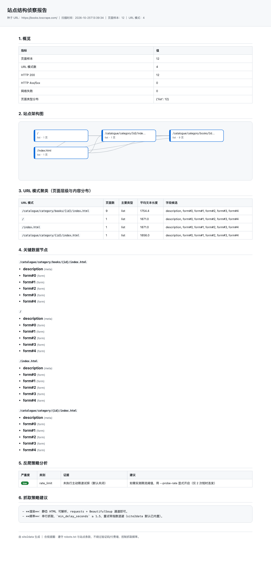
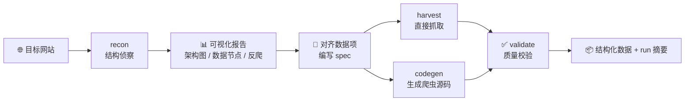

<div align="center">

# 🌐 site2data

### 网站结构解析与数据抓取 Skill

**让 AI Agent 先看懂网站，再精准收割数据。**

给它一个网址 → 产出含 **站点架构图 · 关键数据节点 · 反爬策略分析** 的可视化侦察报告；
指定几个字段 → 直接抓取数据，或生成一份 **结构清晰、能独立运行的 Python 爬虫**。

[](LICENSE)
[](https://www.python.org/)
[](https://github.com/Jiboyu78/site2data/pulls)
[](https://www.workbuddy.cn/)

English below · 以下为完整中文文档

</div>

---

## 😩 你是否也遇到过

- 想抓一个网站，却要花半天摸清它的页面结构、分页规律、字段藏在哪个 DOM 里；
- 爬虫写到一半才发现撞上反爬（429 / 403 / JS 壳），推倒重来；
- 让 AI 写爬虫，得到一段「跑不起来的伪代码」，异常处理全靠缘分。

**site2data 把这件事拆成两步：先侦察，后收割。** 不打无准备之仗。

## ✨ 核心能力

| 阶段 | 做什么 | 产出 |
|---|---|---|
| 🔭 **recon 侦察** | BFS 爬行 + URL 模式聚类 + 数据节点识别 + 反爬被动探测 | **可视化报告**：站点架构图（Mermaid + 内联 SVG）、页面层级与内容分布、关键数据节点、反爬策略分析与抓取建议 |
| 🎯 **harvest 收割** | 按你指定的数据项写一份 spec，双路径执行 | **结构化数据**（jsonl/csv）或一份**可交付的独立 Python 爬虫源码** |
| ✅ **validate 校验** | 字段填充率、重复 URL、空记录体检 | 质量报告——填不上来会如实告诉你，不静默过滤 |

**为什么是「skill」而不只是脚本？** 面向 AI Agent 设计：单一 CLI 入口 + 命令路由、每步输出机器可读 JSON 摘要、断点续跑、诚实汇报成败。Agent 拿到就能干活，人拿到也能直接跑。

## 📸 效果预览

一次 `recon` 生成的侦察报告（自包含 HTML，离线可看）：



> 亮点：站点架构图自动布局（节点=URL 模式，边=链接关系）、URL 聚类表、数据节点清单、反爬发现按严重度排序、给出抓取模式与频率建议。

## 🧭 工作流一览



## 🚀 60 秒上手

```bash
# 1. 克隆（WorkBuddy 用户也可直接作为 skill 安装，见下）
git clone https://github.com/Jiboyu78/site2data.git
cd site2data

# 2. 依赖（仅 requests + beautifulsoup4，lxml/PyYAML 可选）
pip install -r scripts/requirements.txt

# 3. 先侦察——看看这个站长什么样
python scripts/site2data.py recon https://books.toscrape.com/ --max-pages 20

# 4. 打开 site2data_out/<host>_<时间戳>/report.html 看可视化报告
```

再抓数据（以图书站练手为例）：

```bash
# 按示例规格小批试抓 10 条
python scripts/site2data.py harvest examples/example-spec.json --out out

# 或者：要一份能交付的 Python 爬虫源码
python scripts/site2data.py codegen examples/example-spec.json -o books_crawler.py
python books_crawler.py --limit 20 --out out     # 生成物只依赖 requests+bs4，随处可跑
```

## 📦 两种使用方式

**① 作为 WorkBuddy Skill（推荐给 Agent 用户）**

把本仓库放进 `~/.workbuddy/skills/site2data/`，即可被 Agent 自动触发：
「帮我分析一下 xxx 网站的结构」「抓取 xxx 的商品数据」→ 自动走侦察 → 报告 → 定制抓取全流程。

**② 作为独立 CLI / Python 库**

不依赖任何 Agent 平台，`scripts/site2data.py` 就是普通命令行工具；
`site2data_lib/` 是干净的 Python 包（core / recon / crawl / export），可直接 import 二次开发。

## 🛠 命令速查

| 命令 | 用途 | 常用参数 |
|---|---|---|
| `recon <URL>` | 站点侦察 + 可视化报告 | `--max-pages` `--max-depth` `--probe-rate` |
| `harvest <spec>` | 按规格直接抓取 | `--out` |
| `codegen <spec>` | 生成独立 Python 爬虫 | `-o crawler.py` |
| `validate <records> <spec>` | 结果质量校验 | |
| `config` | 查看生效配置 | |

## 📝 数据规格（spec）示例

抓什么、怎么抓，全在一份 JSON 里说清楚（也支持 YAML）：

```json
{
  "name": "books_demo",
  "mode": "list_detail",
  "list": {
    "url": "https://books.toscrape.com/",
    "item_selector": "article.product_pod",
    "link_selector": "h3 a"
  },
  "detail": {
    "fields": {
      "title":  { "selector": "div.product_main h1", "transform": "strip" },
      "price":  { "selector": "p.price_color", "transform": "regex:([0-9.]+)" },
      "upc":    { "selector": "table tr:nth-child(1) td", "optional": true }
    }
  },
  "limits": { "max_items": 10, "delay_seconds": 0.5 }
}
```

三种模式覆盖常见场景：`list_detail`（列表→详情）、`url_list`（现成 URL 批量）、`detail_only`。
字段支持 text/html/attr 抽取 + strip/regex/number 等变换，完整 schema 见 [`references/spec-schema.md`](references/spec-schema.md)。

## 🤖 codegen 生成的爬虫长什么样

不是玩具代码——**交付级源码**：

- `@dataclass` 记录模型 + 全链路类型标注
- 指数退避重试（429/5xx/网络错误，尊重 `Retry-After`）
- **逐条异常隔离**：单条失败只记录，不中断批次
- `progress.json` 断点续跑，`run_summary.json` 诚实汇报成败
- argparse CLI（`--limit / --out / --resume`），logging 规范
- **零内部依赖**：只需 `requests` + `beautifulsoup4`，拷走即用

## 🏗 模块化架构（易于扩展）

```
site2data/
├── SKILL.md                  # Agent 工作流与硬约定
├── scripts/
│   ├── site2data.py          # 唯一 CLI 入口（命令路由）
│   ├── requirements.txt      # 依赖管理
│   └── site2data_lib/
│       ├── core/             # 配置三层加载 / HTTP 限速退避 / robots 门禁 / 数据模型
│       ├── recon/            # sitemap / BFS 聚类 / 数据节点 / 反爬探测 / 可视化报告
│       ├── crawl/            # spec 校验 / 抓取执行 / 爬虫生成 / 结果校验
│       └── export/           # jsonl/csv/json/md 导出 / run 摘要
├── references/               # 配置说明 / 反爬策略库 / spec schema / 代码规范 / 扩展指南
├── assets/templates/         # 爬虫骨架模板
└── examples/                 # 示例 spec
```

新增探测器、导出格式、字段变换、渲染通道、CLI 命令？看 [`references/ext-guide.md`](references/ext-guide.md)，都是「新文件 + 挂注册表」的事。

## ⚙️ 配置

三层配置（CLI 参数 > 工作区 `site2data.config.json` > 技能级 > 内置默认），礼貌速率默认 1 req/s。

```bash
python scripts/site2data.py config    # 查看当前生效值
```

| 高频键 | 默认 | 说明 |
|---|---|---|
| `min_delay_seconds` | `1.0` | 全局请求最小间隔 |
| `max_pages` / `max_depth` | `40` / `3` | 侦察样本规模 |
| `respect_robots` | `true` | robots.txt 门禁 |
| `harvest_max_items` | `100` | 抓取默认上限 |

全部键位与环境变量见 [`references/config-guide.md`](references/config-guide.md)。`.gitignore` 已内置密钥/凭证/运行时产物拦截规则。

## ⚠️ 合规红线

- 默认遵守 **robots.txt** 与站点条款；
- **不绕过**验证码、人机验证、付费墙、登录墙——需要登录态请用你自己有权访问的 Cookie；
- 礼貌抓取：限速 + 退避，不并发轰炸；
- 抓取结果如实汇报：失败项单列清单，填充率不足先修选择器再放量。

> 本工具用于合法的数据采集与研究（如公开数据集构建、竞品信息整理、个人知识库归档）。使用者需自行确保抓取行为符合目标站点条款与当地法律。

## ❓ FAQ

**Q：会把网站抓挂吗？**
默认 1 请求/秒 + 退避重试 + robots 门禁。侦察默认最多 40 页样本，抓取默认上限 100 条——都是保守值。

**Q：SPA / JS 渲染的站点怎么办？**
报告会标记 `js_shell` 并给出建议：优先找站内 JSON 接口（写进 spec 的 `list.pages`，最稳），或走 Playwright 渲染通道（扩展点已预留）。

**Q：生成的爬虫能脱离这个仓库跑吗？**
能。codegen 产物只依赖 `requests` + `beautifulsoup4`，单文件即可运行。

**Q：和通用爬虫框架（Scrapy/Crawlee）什么关系？**
互补。site2data 是「侦察 + 定制 + 交付」的 AI 工作流层：先帮你把站点摸透、把代码写对；复杂长跑任务可以再落到专业框架。

## 🗺 Roadmap

- [ ] Playwright 渲染通道（JS 壳站点）
- [ ] JSONPath / 接口抓取字段抽取
- [ ] 更多报告图表（抓取覆盖率、字段质量趋势）
- [ ] spec 可视化编辑器

欢迎 PR / Issue 提需求 👋

## 📄 License

[MIT](LICENSE) © 2026 Boyu Zheng

---

<div align="center">

**如果这个项目帮你省下了摸站结构的时间，点个 ⭐ Star 支持一下吧！**

*Star 是免费的，但对开源作者真的很重要。*

</div>

---

<details>
<summary><b>English Summary</b> (click to expand)</summary>

**site2data** — a website structure analysis & data extraction skill for AI agents.

- **Phase 1 · Recon**: crawl a site, cluster URL patterns, detect data nodes and anti-bot measures → a **visual report** (site architecture diagram, key data nodes, anti-scraping analysis).
- **Phase 2 · Harvest**: describe the data you need in a small spec → fetch it directly, or **generate a clean, standalone Python crawler** (typed, retried, checkpointed; only needs `requests` + `beautifulsoup4`).

```bash
pip install -r scripts/requirements.txt
python scripts/site2data.py recon https://example.com
python scripts/site2data.py harvest examples/example-spec.json
```

Works as a [WorkBuddy](https://www.workbuddy.cn/) skill or a plain CLI. See the Chinese docs above for details — PRs welcome!

</details>
